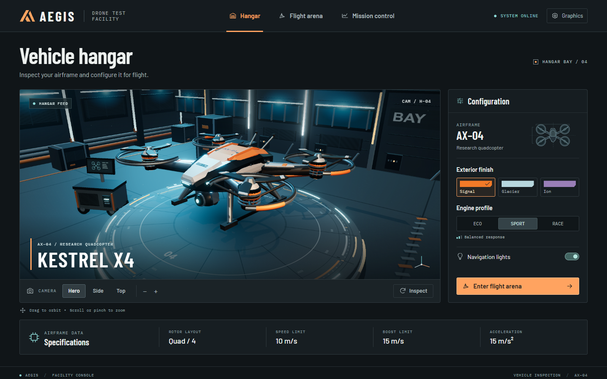

# AEGIS — Drone Test Facility

Inspect the procedural Kestrel X4, fly a 60-second indoor gate circuit and review the recorded flight. The application runs locally with Next.js, React Three Fiber, Three.js and SQLite. Models, surface graphics, lighting and environmental details are generated in the browser. Fonts ship with the application.



## Run locally

Use Node **26.8.1** and npm **11.19.0** with a WebGL 2 browser. From this repository run

```sh
npm ci
npm run db:setup
npm run dev -- --hostname 127.0.0.1 --port 3101
```

Open [the facility](http://127.0.0.1:3101). Database setup generates the Prisma client and applies the checked-in migration. By default it creates `prisma/dev.db`. To choose another local database, copy `.env.example` to `.env` and set `DATABASE_URL`. The default works without an environment file.

For the production build, stop the development server, then run

```sh
npm run build
npm run start -- --hostname 127.0.0.1 --port 3101
```

## Use the facility

- **Hangar** — drag to orbit, scroll or pinch to zoom, or use the camera and zoom buttons. Inspect starts a turntable view. Choose a finish, engine profile and navigation lights, then enter the flight arena.
- **Flight arena** — start the countdown and fly through the amber gate toward the far end of the hall. The illuminated floor path connects the gates. Each correct gate earns 1,000 points. Each new collision costs 150. Finishing all five gates adds ten points per whole remaining second, with tenths of a second scored individually.
- **Mission control** — inspect the current speed, altitude, energy and elapsed time. Select a channel and move the slider or pointer to inspect a recorded sample. The latest 40 mission summaries and the ten highest-scoring flights are read from SQLite. Full traces stay in memory for the current flight.
- **Graphics** — switch LOW, MEDIUM or HIGH, or enable the performance readout. Benchmark and performance URLs lock HIGH quality at a rendering pixel ratio of 1.5.

| Input | Action                          |
| ----- | ------------------------------- |
| W / S | Forward / back                  |
| A / D | Left / right                    |
| Q / E | Descend / ascend                |
| Shift | Hold boost                      |
| Space | Pause / resume an active flight |
| R     | Reset to the start pad          |

Touch controls support simultaneous held inputs. Leaving the range, hiding the tab or losing window focus pauses an active mission. The active sortie retains its starting engine and finish. A reset discards the unfinished attempt. Both a successful finish and a timeout produce an archive record.

## Verify and capture

Install the Chromium runtime once. Linux CI can use `npx playwright install --with-deps chromium`.

```sh
npx playwright install chromium
npm run test:all
```

The suite checks TypeScript, ESLint, Vitest, the production build and Playwright. Playwright starts its own production server on port 3101 and migrates a fresh SQLite database under `prisma/.test/`. Stop any server using that port, or choose another in PowerShell with `$env:PLAYWRIGHT_PORT='34103'`. A real timeout test takes about one minute. `npm run test:e2e` can be repeated against an existing build. Set `AEGIS_E2E_DEV=1` to exercise the development server.

With the production server running separately on port 3101, run `npm run capture`. To capture a different port, set `AEGIS_BASE_URL` to that server's loopback URL. The script writes the five presentation images to `artifacts/screenshots/` and records live frame and browser measurements in `artifacts/runtime.json`.

| View             | Query string                                     |
| ---------------- | ------------------------------------------------ |
| Hangar hero      | `?benchmark=1&seed=42&scene=hangar&camera=hero`  |
| Hangar top       | `?benchmark=1&seed=42&scene=hangar&camera=top`   |
| Flight chase     | `?benchmark=1&seed=42&scene=flight&camera=chase` |
| Mission control  | `?benchmark=1&seed=42&scene=telemetry`           |
| Live performance | `?perf=1`                                        |

Presentation views fix the starting configuration, seed and idle animation phase. The telemetry presentation runs three deterministic reference circuits and labels the data. Demo records stay out of SQLite.

## Source map

| Path                                           | Responsibility                                                                             |
| ---------------------------------------------- | ------------------------------------------------------------------------------------------ |
| `src/features/flight/`                         | Fixed-step integration, profile parameters, collision handling, gate crossings and scoring |
| `src/stores/facility.ts`                       | Shared controls, sortie lifecycle, telemetry samples and retryable archive submissions     |
| `src/components/three/`                        | Airframe fabrication, facility geometry, cameras, lighting, optics and renderer statistics |
| `src/components/ui/`                           | Module navigation, configuration, pilot controls, charts and archive                       |
| `src/features/telemetry/demo.ts`               | Deterministic reference flights through the same physics engine                            |
| `src/app/api/missions/`, `src/lib/`, `prisma/` | Validated HTTP interface, Prisma client and local database schema                          |
| `tests/e2e/`, `scripts/`                       | Browser scenarios, isolated test server and reproducible capture                           |

The local archive accepts client-reported results. It checks structure, score, outcome, elapsed time and basic physical bounds. A client can fabricate a plausible record. See [the benchmark report](BENCHMARK_REPORT.md), [machine-readable metrics](BENCHMARK_METRICS.json) and [the original comparison protocol](docs/BENCHMARK_PROTOCOL.md).
